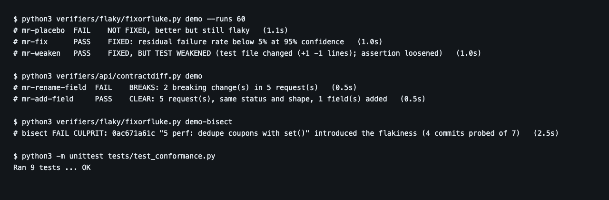
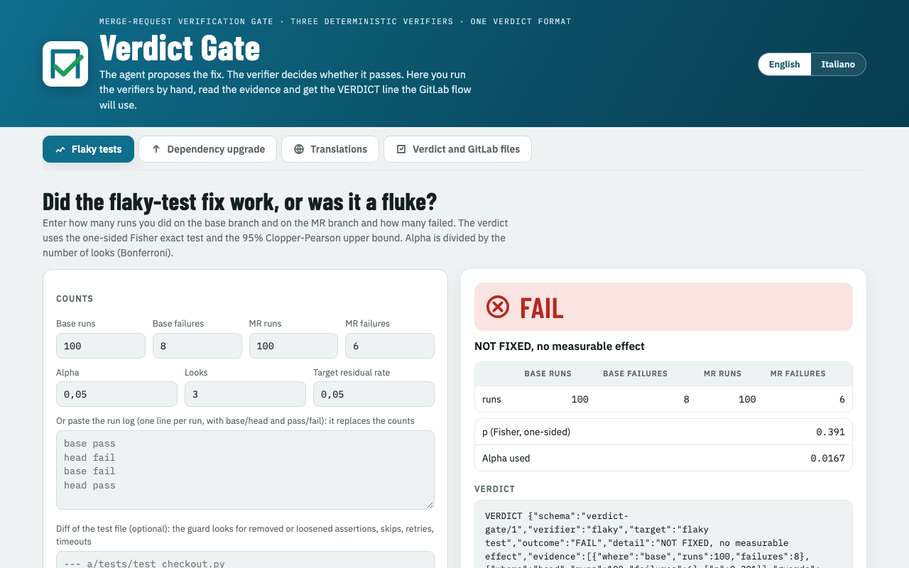
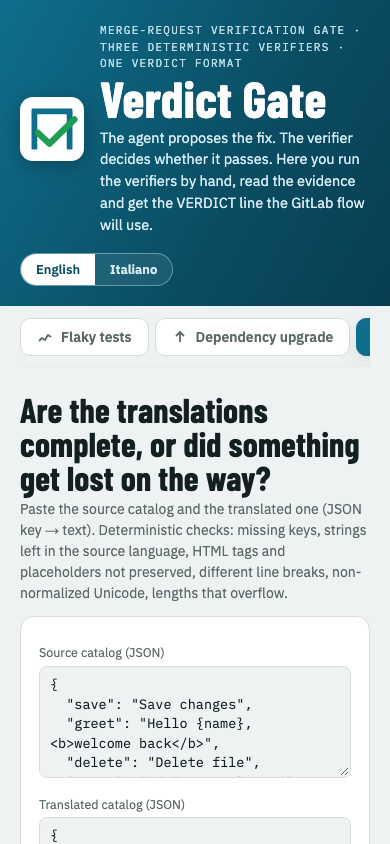
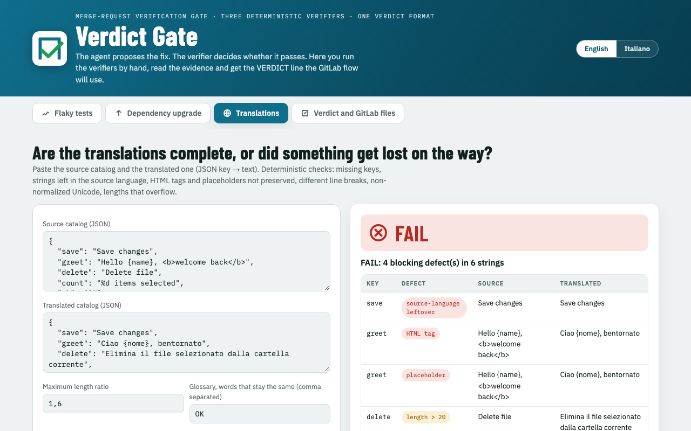

# Verdict Gate

**AI proposes. Evidence decides.**

A merge-request gate for GitLab with pluggable, deterministic verifiers. Each verifier runs as a CI job, compares the merge request (MR) with its base branch, and prints one line to the job log:

```
VERDICT {"schema":"verdict-gate/1","verifier":"flaky","outcome":"FAIL","detail":"NOT FIXED, no measurable effect","evidence":[{"where":"base","runs":100,"failures":8},{"where":"head","runs":100,"failures":6},{"p":0.39}],"guards":[],"needs_human":true}
```

Four outcomes, always the same: `PASS`, `FAIL`, `UNSURE`, `BROKEN`. The evidence is something a person can re-check in a minute. The verifiers decide. An AI agent, if you use one, only reports the line: it never changes an outcome or a number.


*Real output of the demo commands below, rendered in a browser. The flaky demo is random by design, so the wording of the placebo line can differ between runs.*

## Why

A test that fails 15% of the time still passes three runs in a row 61% of the time (0.85^3 = 0.614). Three greens prove nothing. A release note says what changed for everyone, not which line of your code will break. Verdict Gate measures instead of trusting.

## Requirements

- Python 3.9+ (standard library only) and git for `flaky`, `i18n`, `perf` and `api`.
- Node 20+ and npm for `upgrade` (two dependencies: the TypeScript compiler and semver, pinned in `verifiers/upgrade/package-lock.json`).
- No API key, no account.

## Quick start (all commands below were run on a clean copy of this repository)

```bash
# flaky: builds a temp repo with a real flaky bug and three MRs (placebo, real fix, weakened test)
python3 verifiers/flaky/fixorfluke.py demo --runs 60
# -> placebo FAIL, real fix PASS, weakened test "FIXED, BUT TEST WEAKENED"

# i18n: the German catalog has five of the classic defects, the Italian one is clean (exit code 2 = FAIL, on purpose)
python3 verifiers/i18n/i18n_gate.py --source demo-app/locales/en.json --targets 'demo-app/locales/*.json' --glossary OK

# perf: about 30 to 60 seconds. Fast MR: FASTER; placebo: NO MEASURABLE DIFFERENCE; slower MR: SLOWER
python3 verifiers/perf/speedorfluke.py demo

# bisect: eight commits, finds "5 perf: dedupe coupons with set()" in four probes
python3 verifiers/flaky/fixorfluke.py demo-bisect

# api: renamed field + type change: BREAKS; added field: CLEAR
python3 verifiers/api/contractdiff.py demo

# upgrade (needs npm and network access to the public npm registry; NOT run for this README)
cd verifiers/upgrade && npm ci && cd ../.. && node verifiers/upgrade/verdict.mjs demo
```

Each command prints `VERDICT {...}` lines. `python3 schema/check.py verdict.json` validates one against `schema/verdict-v1.json`, and `schema/exit.py` maps outcomes to exit codes (0, 2, 3, 5, 6).

Run on a real repository:

```bash
python3 verifiers/flaky/fixorfluke.py compare --repo . --base origin/main --head HEAD --test "python3 -m unittest -q test_checkout" --runs 100
python3 verifiers/flaky/fixorfluke.py bisect  --repo . --good v1.2.0 --bad HEAD --test "python3 -m unittest -q test_checkout"
python3 verifiers/api/contractdiff.py compare --repo . --base origin/main --head HEAD --config api-contract.json
```

Use `--help` on each script for all options.

## The verifiers

| Folder | Question it answers | Decides with | Guard |
|---|---|---|---|
| `verifiers/flaky` | Did the flaky-test fix work, or was it a fluke? | 100 alternating runs per side, one-sided Fisher exact test, 95% Clopper-Pearson upper bound, Bonferroni across looks | diff of the test file: removed or loosened assertions, skips, retries, timeouts |
| `verifiers/flaky` (`bisect`) | Which commit made the test flaky? | sequential bisection: a commit is stable after 59 clean runs, flaky at the first failure | probes listed in the evidence |
| `verifiers/upgrade` | If I upgrade this dependency, what stops working? | real exports and `.d.ts` types of both versions, crossed with the exact call sites in your code | re-run after the fix; `REVIEW` when the installed version is inferred |
| `verifiers/i18n` | Are the translations complete? | missing keys, source-language leftovers, tags and placeholders, line breaks, Unicode NFC, length overflow | the source catalog is a protected file |
| `verifiers/perf` | Is the MR really faster? | 30 alternating benchmark runs per side, Mann-Whitney U test, bootstrap 95% CI of the median gain | the benchmark file must not change |
| `verifiers/api` | Does the MR break the API contract? | starts the service on base and on head (two git worktrees), sends the same requests to both, diffs status code and response shape recursively | values are compared only where a request sets `compare_values` |

The `api` verifier works on a running service and a list of requests (`api-contract.json`), not on an OpenAPI document. Anything not listed in that file is not checked.

What each verifier cannot see is printed in every verdict under `limits`. For example, `flaky` measures only what it runs: a flakiness that shows up only in another environment is reported as not reproduced.

### flaky, in numbers

11 failures out of 60 on base versus 0 out of 60 on head: p = 0.000295, upper bound 4.87%, `FIXED`. 8 versus 6: p = 0.39, `NOT FIXED, no measurable effect`. 3 versus 0: p = 0.12, `NEED MORE RUNS: 59`. Those numbers are unit tests in `tests/test_conformance.py`. A MR that loosens the assertion gets `FIXED` from the statistics alone and `FIXED, BUT TEST WEAKENED` from the guard.

## Repository layout

```
verifiers/flaky/        fixorfluke.py: rerun, alternating runs, exact test, diff guard, bisect, demo MRs
verifiers/upgrade/      Node engine (own README, tests, demo app): upgrade checks from real exports and types
verifiers/i18n/         i18n_gate.py: translation catalog checks
verifiers/perf/         speedorfluke.py: benchmark comparison
verifiers/api/          contractdiff.py: API shape comparison
schema/                 verdict-v1.json (the contract), check.py (validator), exit.py, merge.py
templates/              verify.yml: CI/CD component that picks the verifier from the MR label
                        monitor.yml: scheduled job that re-measures quarantine and dependencies on main
.gitlab-ci.yml          self-test, verify, monitor, package
verdict-gate.toml       policy: alpha, target, rounds, protected files, hands_off
demo-app/               small apps with deliberate defects, used by the demos
mcp/                    stdio MCP server exposing the verifiers as tools, plus a client example
console/index.html      single-file web console (English and Italian) to run the verifiers by hand
.gitlab/duo/            optional agent and flow definitions for the GitLab Duo Agent Platform
tests/                  conformance tests and fixtures
images/                 screenshots used in this README
```

## In GitLab

`templates/verify.yml` is a CI/CD component: label an MR `upgrade`, `flaky-fix`, `flaky-bisect`, `i18n`, `perf` or `api` and the matching verifier runs as the `verdict-gate:verify` job. A FAIL verdict makes the job exit with code 2 on purpose. `templates/monitor.yml` adds a scheduled Monday job. Policy lives in `verdict-gate.toml` (`alpha`, target residual rate, rounds, protected files, a `hands_off` switch).

The optional files in `.gitlab/duo/` define a custom agent and a flow for the GitLab Duo Agent Platform that read the VERDICT line, post one discussion on the MR and ask a human before merge. They are definitions for a service you need to have enabled on your own GitLab; the gate works without them.

## MCP server

`mcp/verdict_gate_mcp.py` is a Model Context Protocol server (stdio, standard library only). It exposes `verify_flaky`, `verify_upgrade`, `verify_i18n`, `verify_perf`, `verify_api`, `bisect_flaky`, `check_verdict`, `get_policy` and `demo` as tools, so any MCP client can run a verifier on demand and get the verdict-gate/1 object back. It never alters an outcome. `.mcp.json` registers it for clients that read project-level MCP files. Quick check without a client: `python3 mcp/verdict_gate_mcp.py --selftest`. See `mcp/README.md`.

## Console

`console/index.html` is a single-file web console. Open it in a browser: no server and no build. It runs the statistics for the flaky verifier and the translation checks in the page, shows the evidence, and copies the VERDICT line and an MR comment. (It loads a web font from Google Fonts; without network it falls back to system fonts.)

| Desktop | Phone width |
|---|---|
|  |  |


*The translations tab: a FAIL verdict with the defect table (leftover source-language string, lost HTML tag, lost placeholder, length overflow).*

## Tests

```bash
python3 -m unittest -v tests/test_conformance.py     # 9 tests, about one minute
cd verifiers/upgrade && npm ci && npm test            # Node tests for the upgrade engine (needs npm)
```

Run on this repository: 9 of 9 Python tests passed. The Node tests were not run for this README.

Honest note: the conformance suite contains statistical tests that run real, timed processes. Under heavy machine load one of them can fail on an occasional run. If it does, run it again on an idle machine before drawing conclusions.

## Limits

- Each verifier measures only what it runs and says so under `limits` in its verdict.
- `upgrade` judges only the API members your code touches. A behavior change that keeps the same signature is not detected.
- The statistics need enough runs: with few runs the verdict is `UNSURE`/`NEED MORE RUNS`, not a guess.

## Contributing

Issues and pull requests are welcome. Keep the rule that makes the project useful: a verifier decides from a measurement, prints one `VERDICT` line that validates against `schema/verdict-v1.json`, and states what it cannot see. Please add a test in `tests/` for any new outcome, and keep the Python verifiers on the standard library.

Written with AI help, reviewed by the author.

## License

MIT, copyright Capitan AI. See `LICENSE`. Third-party notes are in `THIRD_PARTY_LICENSES.md`.
